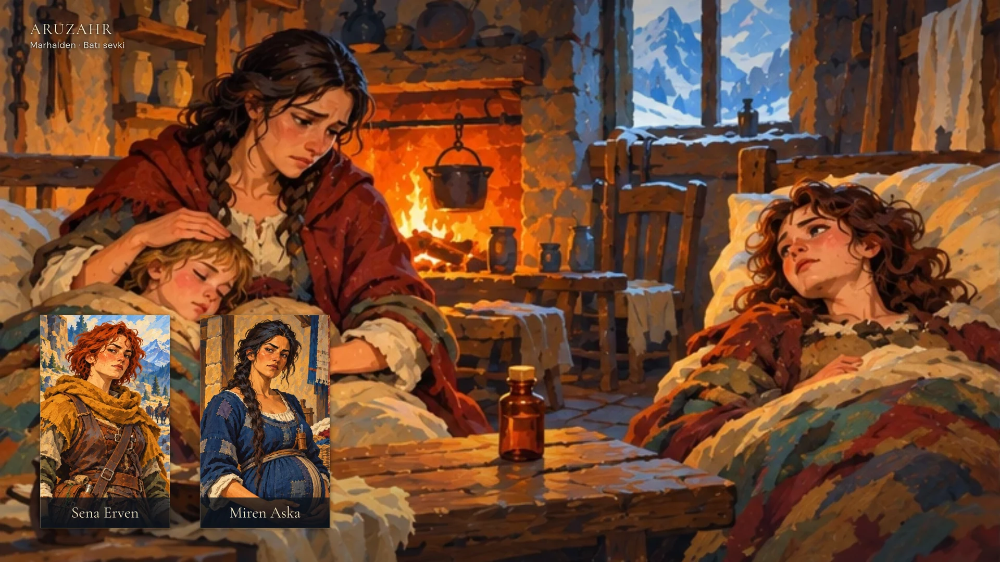

# On Kış Kararı — yeni oturum rehberi

Bu yolculuk, kullanıcının verdiği on ahlaki ikilemin Aruzahr'a uyarlanmış yeni alternatif macera taslağıdır. Mevcut kanonda oynanmış olay sayılmaz. Darbe öncesinde geçer; Eryndorn tahtta kalır. Yeni kaynak, 25–26 Ekim 2026 yazar çalışmasıdır. Güncel baskı üç oyuncu, 1. seviye başlangıç için 61 sahne içerir. [İlk oturum rehberi](../../web/public/dm/ILK-OTURUM.md), yedi başlangıç sahnesini ve gösterilecek resimleri sırayla verir. [Önce yazılan master prompt](../tasarim/YAYIN_VE_ON_GOREV_MASTER_PROMPTU.md).

## İlk kullanım

1. Güncel siteyi başlatıp **Yayın Masası**na gir. Hikâye hazır açılır; şifre veya dosya yükleme gerekmez.
2. Sade akıştan başlangıç ya da kaldığın sahneyi seç. **Nerede / ne zaman / amaç** ve kullanılacak görseller aynı ekrandadır.
3. Anlatımı oku; **Bu sahneyi göster** ile seçili arka plan ve portreleri oyuncu ekranına gönder. Yalnız ileri/geri gitmek canlı görüntüyü değiştirmez.
4. Kararı not edip sıradaki adıma geç. Ayrıntılı zar/karşılaşma notları gerektiğinde açılır.

[Kısa kullanım rehberi](SADE_HIKAYE_MASASI.md). İndirme isteğe bağlıdır: [şifresiz dosyalar](../../DM_NOTLARI.md). Kendi paketlerin ve önceki düzenlemelerin otomatik değiştirilmez. Gelişmiş masada v1/v2 dosyaları ve kapsamlı yayın araçları korunur.

## Yeni içerik

10 görev, 30 adımlı sahne; **8 kişi portresi ve 20 sahne resmi**. Sena Erven, Miren Aska, Bera Hald, Iven Rusk, Elda Sorren, Neris Vel, Maeron Vesk ve Taren Olt genel karakter dizininde bulunur. Kamusal biyografiler gizli görev rollerini ve gelecekteki sonuçları açıklamaz. Görseller görsel kütüphanesine ve galeriye kayıtlıdır. İn, küçük köprü ve kamp için kesin yeni atlas koordinatı uydurulmaz.

Yol Marhalden, Harven, Mavric, Frostbay, Ternhaven ve Dranthol bağlantılarını kullanır. Kral Yolu Marhalden'de biter; Cevher Çizgisi yapılmamıştır. Yolculuk günleri ara sahnelerle atlanabilir. Parti bileşimi ve seviyesi bilinmediği için kontroller ve karşılaşma profilleri düzenlenebilir öneridir. Bütün üçüncü yollar kapatılmaz; oyuncular yaratıcı bir çözüm bulursa başarıları gizli bir cezayla geri alınmaz.

## Ara ekranı ve tam ekran

**Ara ver**, özgün Danstsud haritasını yavaş kamera kayması, sis ve hafif kar katmanıyla sakin bir döngüye alır. Ara mesajına dönüş saatini veya duyurunu yazabilirsin. **Moladan dön** sahneyi olduğu gibi geri getirir; zar/taş/portre kaydı değişmez. Perdeyi kapatma ayrı eylemdir. Hareket azaltma tercihinde döngü durur. Otomatik müzik yoktur.

İzleyici tarayıcısında **F** tam ekranı açıp kapatır; üst sağdaki denetim üzerine gelince veya klavyeyle odaklayınca görünür. Tarayıcı güvenliği nedeniyle izleyicinin ekranını uzaktan zorla tam ekrana alamazsın. OBS Tarayıcı Kaynağında pencere çerçevesi zaten yoktur.

## OBS ve 4K

URL: `http://127.0.0.1:5173/#/broadcast/live`. Yerel sunucu ve yönetim penceresi açık kalsın. OBS Tarayıcı Kaynağına bu adresi ver; genişlik/yükseklik ile OBS tuvalini eşleştir:

| Yayın | Kaynak ve tuval |
|---|---|
| 1080p | 1920 × 1080 |
| 1440p | 2560 × 1440 |
| 4K UHD | 3840 × 2160 |

Kaynağa sağ tık → **Dönüştür → Ekrana sığdır**. Masaüstü monitörünün çözünürlüğü yayını belirlemez. 16:9 sahne bu iki test edilmiş 1080p/4K alanda tam alanı doldurur. Farklı oranlarda oran korunur; resim ezilmez. Karakterler yüzdeyle, tipografi sahne genişliğine göre ölçeklenir. 4K sahne desteği, tüm mevcut illüstrasyonların yerel 4K çözünürlükte üretildiği anlamına gelmez. Zar sesi yönetim tarayıcısından yakalanır. OBS'nin masaüstü uygulaması bu Linux ortamında açılmadı; ayrı tarayıcı profiline aktarım tarayıcıda doğrulandı.

## Sıfırlama

**Oturum → Yeni oturum başlat** sahneyi, taşları, çizimleri, zarı ve yerel görselleri temizler; özel DM defterini korur.

**Gelişmiş masa → Yayın → Bu cihazdaki tüm Aruzahr verilerini sıfırla** özel paket, ilerleme, kararlar, notlar, portreler, kitap işaretleri ve tercihleri de siler. **SIFIRLA** yazmadan çalışmaz. Önce sahne ve DM yedeğini indirme düğmeleri vardır. Ana menüdeki **Verileri sıfırla** aynı Yayın paneline götürür. Yerleşik hikâye sonraki açılışta başlangıç haliyle yeniden gelir; kişisel notlar ve kararlar geri gelmez. Kaynak wiki, çizimler, GitHub dosyaları ve başka uygulamaların kayıtları silinmez. Aynı cihazda farklı originler (`localhost` ve `127.0.0.1` gibi) ayrı depolamadır; işlem yalnız açık origin için geçerlidir.

## Yayın önizlemeleri

Temiz oyuncu sahnesi, 4K tarayıcı kaynağından küçültülmüş önizleme:

Ara ekranı; yavaş harita/sis/kar hareketi bu durağan görüntüde görünmez:

