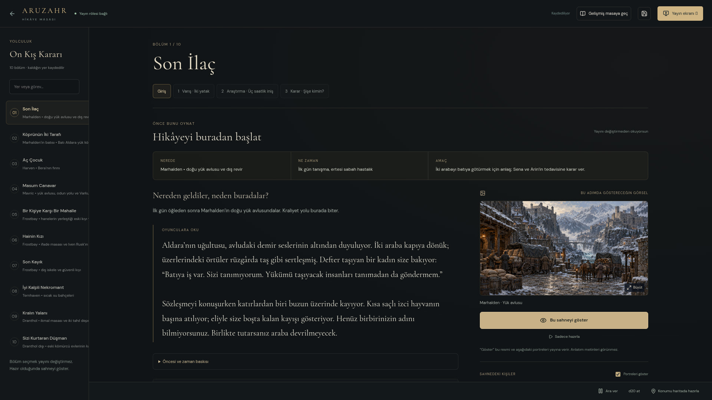

# Sade Hikâye Masası · önceki sürüm

> **27 Ekim 2026:** Sade/gelişmiş geçişi kaldırıldı. Güncel arayüz ve düğmeler için [Tek DM Masası](TEK_DM_MASASI.md) rehberini kullan. Bu sayfadaki eski ekran görüntüleri ve “Bu sahneyi göster / Gelişmiş masaya geç” adları önceki sürüme aittir.

Yerel adres: **`http://127.0.0.1:5173/#/broadcast`**. Siteyi güncelledikten sonra hazır On Kış Kararı hikâyesi açılır. Şifre, paket indirme veya sahneleri tek tek kurma gerekmez. Önceki notların, kararların ve kendi hikâyen varsa korunur.

## Oyun sırasında

1. Soldan **bölümü**, üstteki adımlardan **Giriş** ve numaralı sahneler seç. İlk bölüm yedi, kalan bölümler altışar sahnedir. Avluda bir akşam oynandıktan sonra ertesi sabah revire geçilir.
2. **Nerede / ne zaman / amaç** alanını kontrol et. Kısa olay açıklaması, oyunculara okunacak anlatım ve sırayla yapacakların aynı sayfadadır.
3. Sağdaki manzara ve portreler o adımda kullanılacak görsellerdir. Resme basıp yönetim ekranında büyütebilirsin; bu tek başına yayına gitmez. Portreleri istersen kapat.
4. **Bu sahneyi göster** seçili resmi ve portreleri oyunculara verir. Yalnızca **Sonraki adım** veya bölüm seçmek canlı görüntüyü değiştirmez. “Bu sahne yayında” durumu gönderilen görseli belirtir; ayrı canlı önizlemeyi de açabilirsin.
5. **Not al / bu adımı değiştir** altında kararını yaz, anlatımı veya sahne resmini değiştir. **Sonraki adım** ile devam et. Bölüm sonunda sıradaki bölüme geçilir; bölüm açılışı aradaki yolculuğu anlatır.

Zarlar, karşılaşmalar ve olası sonuçlar ihtiyaç olduğunda açılır. **Ara ver**, **d20 at** ve konumu haritada hazırlama kısayolları bulunur. Haritada çizim, kendi karakterlerini yerleştirme, ses ve kapsamlı sahne düzenleme için **Gelişmiş masaya geç**; **Sade hikâyeye dön** ile geri gel. Hikâye konumu ve kararlar iki görünümde de aynıdır.

## Hazır görsel sırası

Yeni tablolar araştırma ve yolculuk adımlarına bağlıdır; hiçbirini kütüphanede araman gerekmez.

| Bölüm / adım | Gösterilecek manzara |
|---|---|
| Son İlaç · Giriş | Marhalden yük avlusu ve iki araba |
| Son İlaç · Araştırma | Revirin altındaki eski sıcak su galerisi |
| Aç Çocuk · Araştırma | Harven un ambarı |
| Masum Canavar · Varış | Mavric’in kapanan odun yolu |
| Bir Kişiye Karşı Bir Mahalle · Keşif | Frostbay eski su kapısı |
| Son Kayık · Kurtarma | Frostbay dış iskelesi |
| İyi Kalpli Nekromant · Görüşme | Ternhaven sıcak su bahçesi |
| Kralın Yalanı · Doğrulama | Dranthol’un iki deposu |

Önceki 12 sahne ve sekiz portre korunur; toplam **34 sahne resmi + 17 portre + bir canlı çizimi** bu macerada kullanılabilir. Yeni tablolar karanlık, ciddi, ayrıntılı yağlıboyadır. Tek tek üretilir, toplu resimden kırpılmaz. Kaynak çözünürlüğü 4K diye sunulmaz.

## Kayıt, indirme ve OBS

Konum ve kararlar tarayıcıda otomatik kaydedilir. Kendi paketlerin ve düzenlediğin metinler otomatik olarak varsayılan hikâyeyle değiştirilmez. Başlangıç dosyalarını ayrıca almak için [şifresiz indirmeleri](../../DM_NOTLARI.md) kullan. Kişisel kampanyanı taşımak için gelişmiş masadan **Özel kampanya paketini indir**.

OBS adresi değişmedi: **`http://127.0.0.1:5173/#/broadcast/live`**. Yayın ve yönetim pencereleri açık kalmalıdır. Oyunculara hikâyenin DM metni, kararlar veya sonraki sahneler gönderilmez; yalnız açıkça gösterdiğin görsel yayınlanır. Hazır senaryo kullanıcının talebiyle şifresizdir; indirme dosyası senin sonradan yazdığın kişisel notları içermez.

Bütün kayıtları silmek için gelişmiş masada **Yayın** sekmesinin en altındaki sıfırlama düğmesini kullan. Bu kişisel verileri temizler; sonraki açılışta hazır hikâye başlangıç haliyle gelir.

## Ekran önizlemeleri

[Karşılaşma kartı](../gorseller/karsilasma-karti.png) · [Telefon görünümü](../gorseller/sade-hikaye-telefon.png) · [Temiz 4K oyuncu ekranı](../gorseller/sade-hikaye-yayin-4k.png).

Önceki 30 sahneli sürümün doğrulama kaydı ve güncel genişletmenin sonuçları teknik kayıtta ayrı tutulur. [Koşular ve sınırlar](../gelistirme/SON_DOGRULAMA.md).

## 26 Ekim · Karşılaşmalar ve konuşmalar

Hazır hikâye artık **10 bölüm / 61 sahne**. **Masada süre**, **bu sahne ne zaman biter**, **oyuncular duraksarsa** alanları geçişi yönetir. Konuşmalar, soruya göre açılan kısa cevaplar ve oyuncuya okunacak tasvirler olarak ayrıdır.

**Karşılaşma** kartında amacı ve başlangıcı görürsün; turlar, Zırh/Can/saldırı, düşmanın davranışı, bırakma koşulu ve dövüş dışı yollar tek açılır alandadır. Üç oyuncu ve 1. seviye başlangıç esas alınır. İlk galeri bir tek Galeri Kıskacı içerir; bütün macera boyunca 1. seviyede kalmak zorunda değilsiniz.

Alternatif yol düğmeleri yalnız okuduğun sahneyi değiştirir. Canlı görüntü için yine **Bu sahneyi göster** gerekir. Canlı çizimleri de gelişmiş masanın görsel kütüphanesinden manzara olarak gösterilebilir.

[İlk oturum rehberi](../../web/public/dm/ILK-OTURUM.md), yedi adımı ve hangi resmin ne zaman gösterileceğini tek yerde toplar. Güncelleme önceki sağlanan metni tanıyarak genişletir; senin değiştirdiğin anlatımı, görselleri, serbest notları ve kararları korur. Eski adım numarası aynı sahnenin yeni yerine taşınır. Sıfırlama yapman gerekmez.

## Yan olaylar ve kişiler

10 isteğe bağlı olay, 25 bölüm-kişi rehberi ve sonraki duraklarda seçime göre açılan hatırlatmalar eklendi. Sağdaki **Kim kimdir?** alanından birini seçebilir, gerekirse sonraki bölümlerde de el altında tutabilirsin. Sol alttaki **Özel oturum özetini indir** yerel seçim ve notlarını kısa dosyada toplar. [Adım adım kullanım](YASAYAN_YOLCULUK.md).
