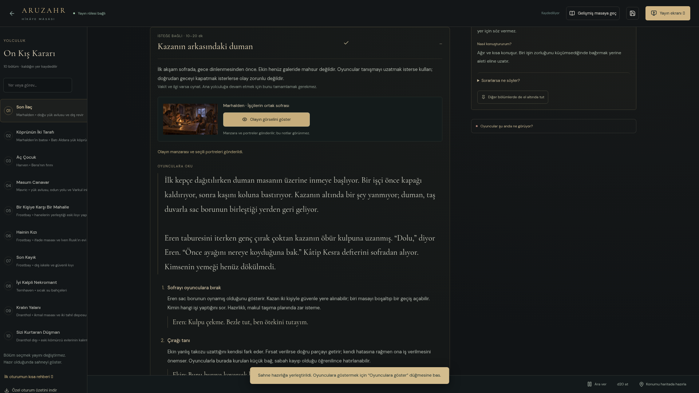

# Yan olaylar ve kişi rehberi

Güncel siteyi açıp **Yayın Masası → Son İlaç → Giriş** seç. Önceki kayıtların varsa kaldığın yer açılır. Yeni içerik için sıfırlama veya dosya yükleme gerekmez.

61 ana sahneye 10 isteğe bağlı olay eklendi. Her olay yalnız uygun adıma geldiğinde kapalı bir kart olarak görünür. Ana görevi sürdürmek için bunları bitirmek gerekmez. Örneğin ilk akşamki **Kazanın arkasındaki duman** bakım ustası Eren ve çırağı Ekin’i tanıştırır; sabah galeride bu kişiler artık yalnız isim değildir. Mavric’te **Aşağıdaki el** kısa bir kurtarma, Frostbay’de **Ödünç hatıra** şüpheli bir tanıklık teklifidir.

## Masada izleyeceğin sıra

1. **İsteğe bağlı** olay kartını aç. Ne zaman devreye girdiğini ve tahmini masa süresini oku.
2. Resmi incele. **Olayın görselini göster** yalnız o manzara ile ilgili portreleri yayına verir. Sadece kartı açmak veya seçim kaydetmek yayını değiştirmez.
3. **Oyunculara oku** tasvirini kullan; altındaki kısa işleri sırayla oynat. Zarlar ve olası yollar ayrıca açılır.
4. **Masada hangi yol seçildi?** bölümünden en yakın sonucu işaretle. Oyuncular başka çözüm ürettiyse **Bu olaya özel not ekle** alanına yaz. Seçenekler otomatik oyun kuralı değildir.
5. İlgili sonraki bölüm veya sahnede **Önceki söz burada karşılık bulabilir** kartı belirir. Yalnız kaydettiğin seçim, onun yankısı ve kendi notun görünür. Sonucu masadaki gerçek olaylara göre uygula.

**Seçimi temizle** sadece o işareti kaldırır; özel notunu silmez. Olayı hiç oynamadıysan bir seçim işaretlemek zorunda değilsin. Böylece sonraki durakta yapılmamış bir işin sonucu uydurulmaz.

## Kişileri el altında tut

Sağdaki **Kim kimdir?** alanı, bu adıma bağlı kişileri öne alır. Diğer bölüm kişileri kapalı listede kalır. Birini seçtiğinde görünüşü, ne istediği, ne bildiği, nasıl konuştuğu ve örnek cevapları açılır. Bu bilgiler DM içindir.

**Diğer bölümlerde de el altında tut** kişiyi sonraki duraklarda da görünür bırakır. Aynı düğmeyle bırakabilirsin. Bu işlem kişiyi oyuncu partisine veya canlı sahneye eklemez.

Yeni Eren Keld, Ekin Sar, Kesra Venn, Haldor Pell, Veyra Senn, Orsa Dren, Dalen Marr ve Ressa Korr’un kamusal biyografileri **Karakterler**, resimleri **Galeri** menüsünde de bulunur. Görev içindeki koşullu davranışlar bu kamusal biyografilerde yaşanmış olay olarak anlatılmaz.

## Oturum bittiğinde

Sol alttaki **Özel oturum özetini indir** düğmesi kaldığın bölüm/adımı, bölüm kararlarını, oynadığın yan olay seçimlerini ve notlarını, el altında tuttuğun kişileri Markdown olarak indirir. Bu kısa okuma kopyasıdır. Bütün sahne düzenini, kişisel dosyalarını ve kampanya verisini taşımak için gelişmiş masadaki **Özel kampanya paketi**ni kullan.

OBS adresi aynı: `http://127.0.0.1:5173/#/broadcast/live`. Yönetim sayfasını OBS kaynağına verme; temiz oyuncu ekranını kullan.

## Önizleme

[Temiz 4K tarayıcı yayın görüntüsü](../gorseller/yasayan-yayin-4k.webp). Çizimlerin kaynak çözünürlüğü, tarayıcı çıkışının çözünürlüğünden ayrıdır.
