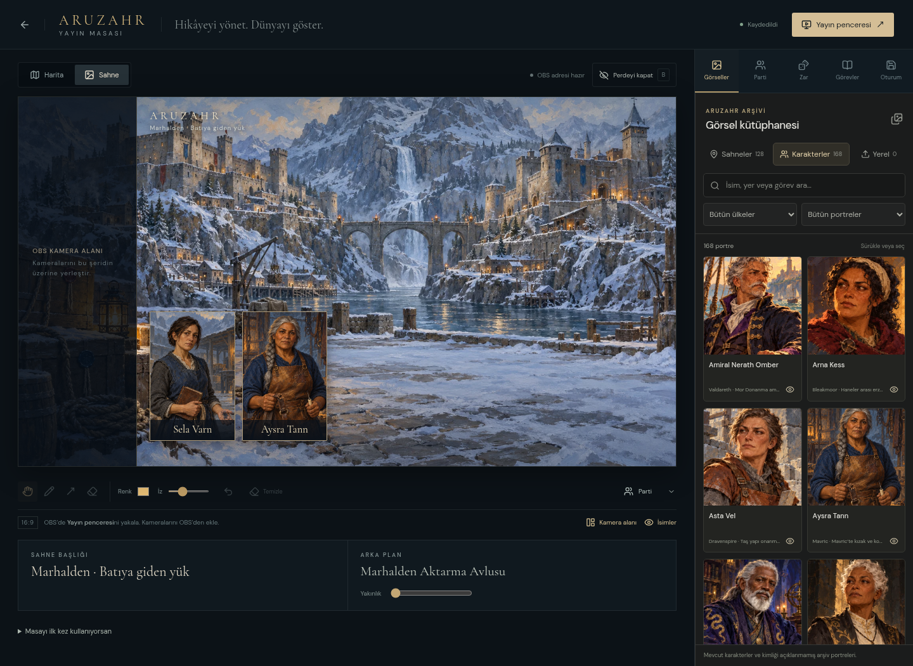
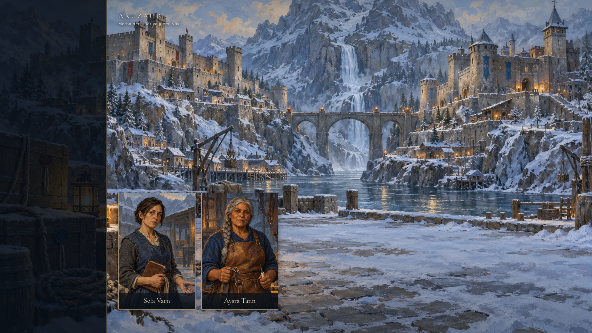
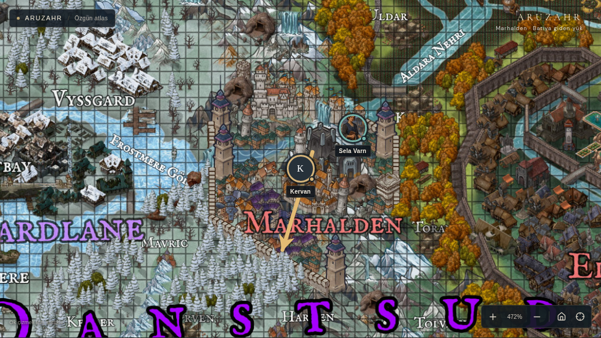

# Aruzahr — Yayın Masası

Güncel varsayılan masa artık hazırlık/canlı ayrımı olan stüdyodur. [Yeni kullanım kılavuzunu](YAYIN_STUDYOSU_KULLANIM.md) kullan. Bu belgedeki önceki arayüz `/#/broadcast/classic` altında korunur; ana OBS adresi `/#/broadcast/live` olarak kalır.

**25 Ekim güncellemesi:** [On Kış Kararı rehberi](ON_KIS_KARARI_KULLANIM.md), 10 görev/30 sahne, görsel hazırlama, karar takibi, ara ekranı, tam sıfırlama ve 4K OBS ayarlarını açıklar. Önceki beşli Yük ve Söz ayrı paket olarak korunmuştur.

24 Ekim 2026. Atlasın yanında, yerel D&D yayını için ayrı bir yönetim masası bulunur. Menüde **Yayın Masası** seçilir. Parti önceden doldurulmaz; kendi oyuncularını, fotoğraflarını ve isimlerini ekleyebilirsin.

## İlk oturum için

1. Windows'ta `baslat/Yayini-Baslat.cmd` dosyasını aç; macOS/Linux'ta `bash baslat/Yayini-Baslat.sh` çalıştır. Eksik bağımlılıkları ve atlası hazırlar, yönetim masasını tarayıcıda açar. Node 22.12 veya daha yenisi gerekir. Elle başlatmak için `web/` içinde `npm ci`, ilk kurulumda `npm run assets`, ardından `npm run dev` kullan. `index.html` dosyasını çift tıklamak yerine bu sunucuyu kullan.
2. **Yayın Masası → Yayın penceresi** ile temiz sahneyi ayrı pencerede aç. OBS’de pencere yakalamaya bu pencereyi seç. Kameraları OBS’den ekle. İstersen **Kamera alanı** ile solda kameralara ayrılmış bir şerit bırak.
3. Görsel kütüphanesinde şehri veya önemli mekânı ara; **arka plan yap**. Karakterler sekmesinden birden çok portreyi sahneye ekle. Portreyi sürükle; sağ alt köşesinden büyüt/küçült. Bir görselin göz düğmesi onu ayrı, büyütülebilen bir katman olarak açar. Sahne başlığını ve arka plan yakınlığını değiştirebilirsin.
4. **Parti** panelinde isim ve portre seç, haritaya ekle. Kendi resimlerini yükleyebilir, baş harfli taş da kullanabilirsin. Parti, dost ve düşman taşlarının renkleri ayrıdır. Karakter portresini doğrudan haritaya bırakmak da taş oluşturur. Taşların boyutu ekranda sabit, konumu özgün 8K haritada sabittir.
5. **Harita** görünümünde kalem, ok ve silgiyi kullan. Çizim, haritayla yakınlaşır ve taşınır. Son çizimi geri alabilir veya tüm çizimleri temizleyebilirsin. Bir taş seçiliyken ok tuşları taşır; Delete kaldırır.
6. **Zar** panelinden d4/d6/d8/d10/d12/d20/d100, adet ve ek değer seç. Zarlar animasyonla görünür, sonuçları yayın penceresine de gider. Ses yönetim penceresinden gelir; OBS’de bu tarayıcının/masaüstünün sesini al. Ses düğmesiyle susturabilirsin. Hareket azaltma tercihi animasyonu kısaltır.
7. **B** tuşu veya **Perdeyi kapat**, oyuncuların gördüğü sahneyi örter. DM defterini açmak için perdeyi kapatman gerekmez; defter yayın penceresine gönderilmez.

OBS'de doğrudan **Tarayıcı Kaynağı** kullanacaksan Oturum → **OBS adresini kopyala** seç. Bu adresi kaynak URL'sine yapıştır; genişlik **1920**, yükseklik **1080** olsun. Yerel geliştirme ve önizleme sunucusunda yönetim görüntüsü, OBS'nin ayrı tarayıcı profiline de aktarılır. Sahneleri yönetmek için yönetim masasını açık tut. Zar sesi yönetim penceresindedir; OBS'de tarayıcı/masaüstü sesini de yakala. Windows pencere başlatıcısının gerçek Windows üzerinde çalıştırılması bu Linux bulutunda doğrulanmadı; altında kullanılan kurulum, atlas ve sunucu komutları doğrulandı.

## Görevler: Yük ve Söz

Marhalden’den Hardlane’e giden tek bir yük sözleşmesi beş kısa macerayı bağlar. Kamusal görev kancaları **Görevler** panelindedir. Yeni kişiler Sela Varn, Deren Olm, Aysra Tann ve Ovel Sarn; yeni yerel mekânlar mevcut şehirlerin içinde yer alır. Şehirlerin kanonik noktaları değişmez.

Kısa oyuncu anlatısı ve kanon kaydı: [Marhalden–Hardlane: Yük ve Söz](../../lore/danstsud/MARHALDEN_HARDLANE_YUK_VE_SOZ.md). İki yeni boyanmış mekân ve dört portre için [görsel kaydı](../arsiv/YAYIN_GORSELLERI.md).

Tam görev sırları, sahnelerin çözüm yolları, karşılaşma önerileri ve gecikmeli sonuçlar kamusal uygulamaya eklenmez. Ayrı verilen **Marhalden-Hardlane-DM.json** dosyasını Görevler → **DM paketi aç** ile içe aktar. Görev kartına basınca özel metni DM defterinde açılır. Markdown veya metin notu da yükleyebilirsin. Paketteki sonuçlar oynanmış olaylar değildir; seçimden sonra kullanılabilecek olasılıklardır. Oyuncu seviyesi ve parti bileşimi verilmediği için karşılaşmalar ayarlanabilir yazılmıştır.

Bir görevin notunu değiştirip başka göreve geçtiğinde değişiklik o görevde kalır. **Defteri indir**, düzenlediğin özel paketi veya serbest notunu ayrı dosyaya kaydeder; bu indirme yayına ya da sahne yedeğine eklenmez.

Sohbetin dosya bağlantısı indirilemiyorsa [şifreli GitHub teslim dosyasını](DM_PAKETI_INDIRME.md) kullan. Şifre yalnızca sohbetten verilir; görevlerin açık metni GitHub'a eklenmez.

## Kayıt ve taşıma

Sahne, çizimler, taşlar, yüklediğin görseller ve son zar bu tarayıcıda otomatik saklanır. Oturum panelinde **Şimdi kaydet**, **Oturum yedeğini indir** ve **Oturum yedeği aç** bulunur. Yedek, yerel portreleri de içerir; başka bilgisayara taşınabilir. DM defteri ve özel görev paketi oturum yedeğine dahil değildir; kendi özel dosyanı ayrıca koru.

Aynı tarayıcı profilindeki pencereler doğrudan eşleşir. Yerel sunucu, OBS Tarayıcı Kaynağı gibi ayrı profillere de yalnızca yayın sahnesini aktarır; kullanılmayan yüklemeler, gizli görsel katmanları ve özel DM notları gönderilmez. Yerel sunucunun sahne belleği kapanınca temizlenir; asıl kalıcı kayıt yönetim tarayıcısındadır. Başka profiller bu kalıcı kaydı paylaşmaz. İnternet üzerinden çok oyunculu eşitleme yapılmaz. Statik barındırmada yerel OBS bağlantısı bulunmazsa aynı tarayıcıdaki ayrı yayın penceresini OBS pencere yakalamayla kullan.

Görseller JPEG, PNG, WebP veya GIF olarak yüklenebilir; tek dosya 8 MB ve 40 milyon piksel sınırını aşamaz. Saklanan resim en fazla 1600 piksele ölçeklenir. Bozuk/yabancı adresli oturum dosyaları reddedilir. Tarayıcı depolaması kapalı veya doluysa durum mesajı gösterilir; kayıt yapılmış gibi sunulmaz.

## Kapsam

Bu masa özgün 2D atlası kullanır. Normal atlasın 2D/3D düğmesi, wiki, galeri, karakterler ve kitaplar ayrı gezinmede korunur. OBS kameralarını, mikrofonlarını veya gerçek oyuncu videolarını siteye göndermene gerek yoktur. Yayın ekranında yalnızca seçilen sahne, görseller, harita taşları, çizimler, başlık ve zar görünür.

## Önizlemeler

Örnek yönetim düzeni: iki yeni karakter portresi, yeni Aktarma Avlusu tablosu ve OBS kamera alanı. Yerleştirilen kişiler örnek sahne düzenidir; kampanyada yaşanmış olay sayılmaz.

Yayına giden temiz 16:9 görüntü:

Özgün harita üzerinde yuvarlak taşlar ve rota çizimi:

