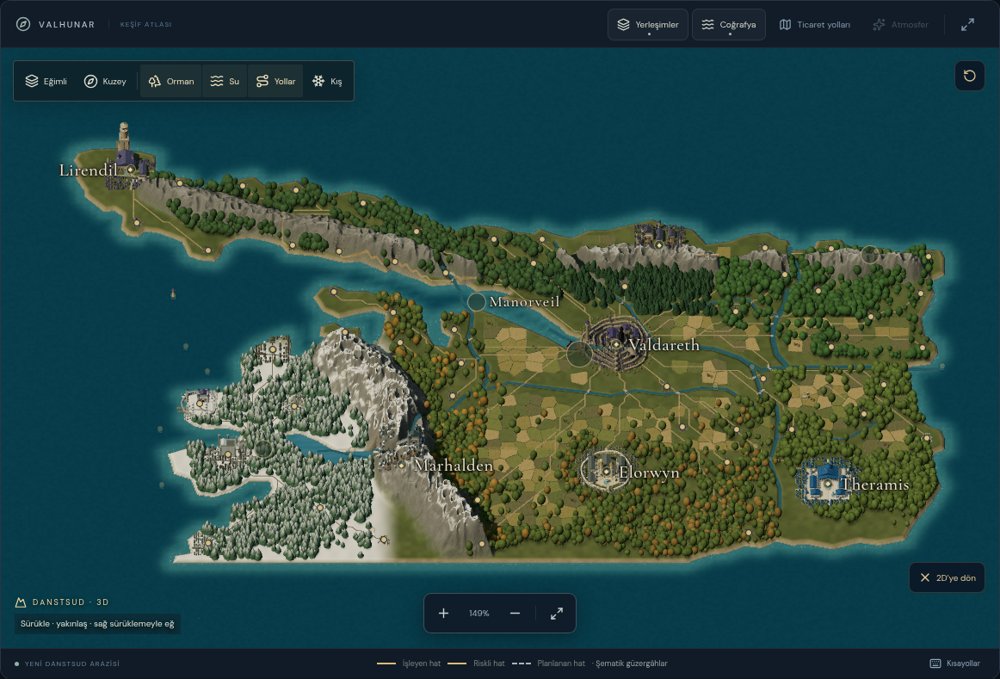
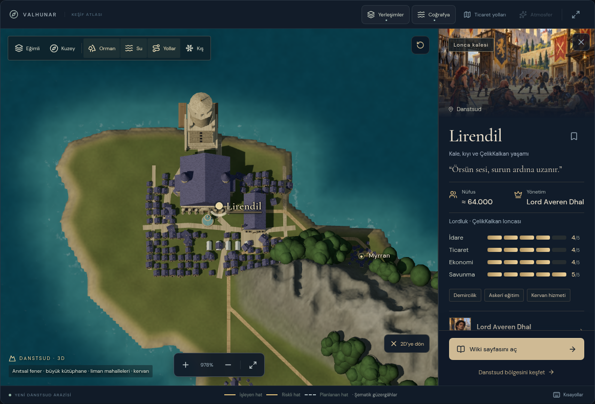
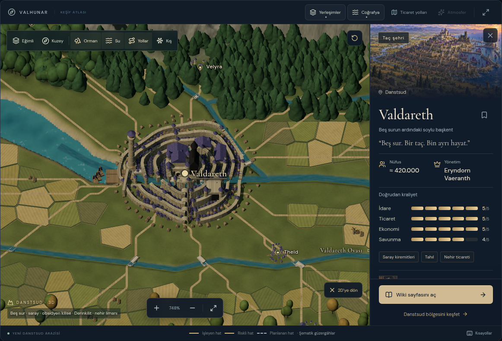
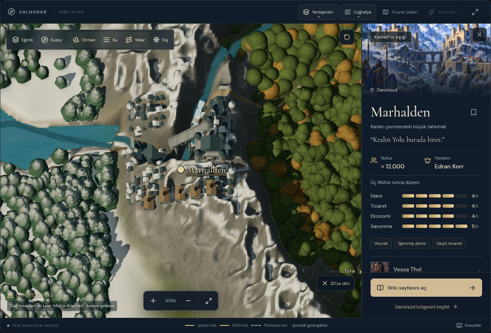
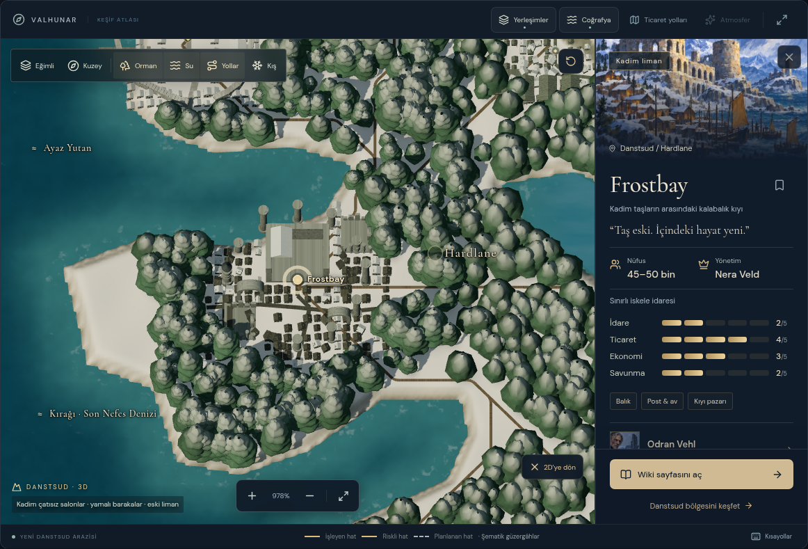
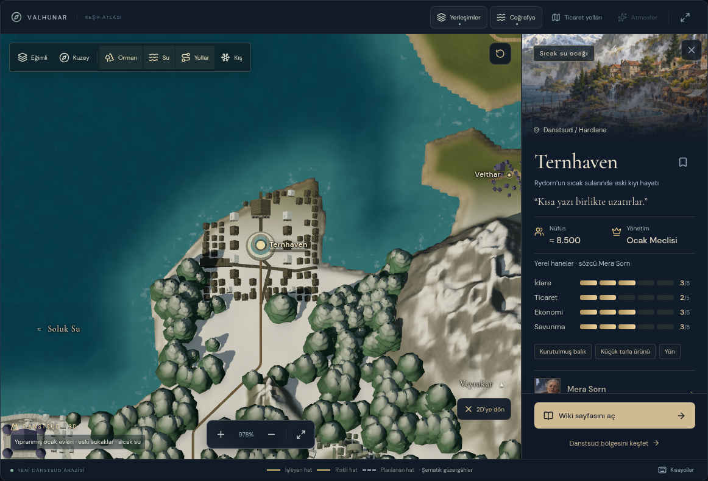

# Aruzahr — Danstsud 3D coğrafya, mimari ve Kral Yolu

11 Ekim 2026 remaster. Kullanıcının son düzeltmesi doğrultusunda [master prompt](3D_ATLAS_MASTER_PROMPTU.md) önce yazıldı, ardından eski resme kabartma ekleyen uygulama değiştirildi. **3D görünüm yeni bir coğrafi sahnedir; özgün harita resmi zemin veya doku olarak kullanılmaz.** İlk kapsam Danstsud, başlangıç görünümü 2D’dir.

## Yeni harita

Kıyı çizgisi, Rydorn uzantısı, Hardlane girintileri ve Frostmere havzası koordinatlı kaynak parçalarından elle çizildi. Bu kapalı vektörlerden yükseltilmiş kara ve su altında kalan taban oluşturulur. Deniz ayrı bir geometridir. Ova/taş/kıyı pigmentleri ve küçük yüzey farklılıkları programatik olarak üretilir; fotoğraf veya kaynak atlas dokusu yüklenmez. Eski resmin kareleri, yazıları, gemileri ve çizilmiş şehirleri yeni zeminde bulunmaz.

Kullanıcının işaretlediği Rydorn, Dorvenhall, Lowvale ve Karlan kuşaklarına dört kesintisiz sırt alanı eklendi; önceki on iki yerel zirve alanı da korunur. Marhalden çevresindeki koridor dağ karakterini sürdürür, nehir yatağı ve yerleşim terasları ayrılır. Zirveler ayrı sırtlar ve taş yüzeyleri oluşturur; yükseklerde ve kaynakta beyaz olan Hardlane topraklarında kalıcı kar vardır. Kış katmanı soğuk alanların karını artırır. Deniz noktaları kara/dağ/orman üretmez. Doğu/Batı Aldara, Serenith ve Teyra, paylaşılan birleşim noktaları olan dokuz akarsu şeridiyle; Frostmere ayrı havzayla gösterilir.

Yedi orman alanında sabit tohumlu, açıklıkları olan doğal kümeler üretilir. Gövdeler, dallar, yuvarlatılmış hacimli yaprak taçları ve katmanlı iğne yapraklı taçlar yakın/uzak ayrıntı kullanır. Ağaçlar kıyı, göl, nehir, çıplak zirve, şehir, tarla ve yol koridorlarından dışlanır. Ovadaki 209 düzensiz komşu parsel gerçek yüzeyi izler; sınırları, ekim sıraları, erişim izleri ve küçük ambar/değirmenleri vardır. Arazi için pigment, normal ve pürüzlülük haritaları yeni yükseklik alanından üretilir; özgün resimden alınmaz.

## Yerleşimler ve kullanım

Danstsud’un **58 yerleşimi** aynı kanonik koordinatlarda modellenir. 11 özel mimari: Valdareth’in beş düzensiz suru, yoğun evleri, sarayı, obsidyen mabedi ve feneri; Marhalden’in iki kıyıya yerleşen kaleleri, nehir dönümünün üstündeki düz kesime dik geçen kemerli köprüsü, dağ terasları ve iki şelalesi; Dorvenhall’in plato üzerindeki sınır kalesi, küçük/büyük atölyeleri ve askeri yerleşkesi; Elorwyn’in geniş meydanı, mabetleri, paladin avlusu ve ruhban okulları; Theramis’in beyaz kuvars sütunları, mavi işlemeli akademileri ve çeşmeleri; Lirendil’in geniş kütüphanesi, kare alt gövdeli/çokgen galerili anıtsal feneri, Çelikkalkan salonu ve kervanları; Frostbay’in çatısız büyük salonları, kırık duvarları ve yamalı barınakları; Dranthol’un kale/feneri; Ternhaven’in eski ve yıpranmış fakat sokak düzeni korunan ocak evleri ve sıcak su havuzu; Kaldmere’in barakaları; Vyssgard’ın depoları. Büyük kentlerde ek sokaklar ve çeşitli büyüklükte mesken mahalleleri; küçük yerlerde daha geniş ev kümeleri, şapel, değirmen, ambar veya gözetleme kulesi bulunur. Üç bağımsız anıt modeli de korunur.

“Danstsud 3D” aç/kapat düğmesi ile görünüm değişir. Harita içindeki “2D’ye dön” düğmesi tam ekranda da kullanılabilir. Model veya noktaya tıklamak mevcut bilgi panelini açar; wiki, arama, kanonik takma adlar ve ticaret durumları korunur. Sürükleme, tekerlek/iki parmakla yakınlaşma, sağ sürüklemeyle eğim, üstten görünüm, kuzeye dönüş, kamera sıfırlama ve ok tuşları çalışır. Kamera wiki dönüşünde hatırlanır. Başka ülkeye gidilince dünya atlası açılır.

Kral Yolu, Lirendil–Valdareth bağlantısı ve başkentten Hardlane dışındaki 51 yerleşime kara üzerinde hesaplanmış dallar oluşturur. Marhalden’de son bulur; Hardlane’in batı şehirlerine bakımlı yol uydurmaz. Kraliyet ağı ve Frostbay merkezli sekiz yerel bağlantı ilk açılışta görünür; “Yollar” düğmesi fiziksel ağları açar/kapatır. Hardlane patikaları kraliyet yolu değildir. “Ticaret yolları” güzergâh vurgularını bağımsız yönetir; Cevher Çizgisi tamamlanmış yol olarak gösterilmez. Yol kıvrımları kıyı denetimiyle yumuşatılır.

Masaüstü ve dar ekran farklı arazi/ağaç yoğunluğu kullanır. Yakındaki ormanlarda dallı taçlar, uzakta ve görüş merkezinden uzak kümelerde daha hafif geometri; her ikisinde yumuşak yüzey normalleri ve yaprak yüzeyi bulunur. Taş derzleri, kiremit sıraları, ahşap damarları, kaya katmanları ve su ayrı yüzey ayrıntısı kullanır. Kar, dik kayada azalır; daha yatay yüzeylerde ve rüzgârla oluşan örtüde belirginleşir. Tarla parçalarında ekim sıraları görünür. Eğik güneş ışığı ve gölgeler yamaç ve yapı hacmini gösterir. Hareket azaltma ve atmosfer kapatma su/kar/buhar hareketini durdurur. Kamera geçişleri kare sayısına değil gerçek geçen zamana göre tamamlanır; değişmeyen sahnenin gölgesi yeniden hesaplanmaz. Gizli sekmede döngü durur; çıkışta GPU kaynakları temizlenir. Motor yükleme, WebGL veya grafik bağlamı sorununda seçili yer korunarak 2D’ye dönülür.

Marhalden seçilince kamera daha yukarıdan bakar; güney sırtının vadi tabanını örtmesi azaltılır. Telefonda alt açıklama yakınlaştırma düğmelerinin üstüne alınır. Başlangıç kadrajı kuzeydeki gereksiz deniz boşluğunu azaltır; şehirlerin kanonik koordinatları ve kıyı geometrisi taşınmaz. Şehir isimleri büyük siyah etiket kutuları yerine harita üzerinde sakin yazılarla gösterilir.

## Üretim önizlemeleri

Danstsud geneli: birbirine bağlanan dağlar, doğal ormanlar ve tarım/yol düzeni.

Lirendil: anıtsal fener, kütüphane ve genişleyen mahalleler.

Valdareth: beş sur, mavi-mor mahalleler, kraliyet kalesi, obsidyen kilise ve denize açılan liman.

Marhalden: iki yakadaki kaleler, köprü, teraslar ve dağdan inen Aldara.

Frostbay: büyük çatısız harabeler ve yamalı kıyı barınakları.

Ternhaven: düzenini koruyan, yıpranmış Hardlane yerleşimi.

## Kaynak ve sınırlar

8K kaynak değiştirilmedi: `Aruzahr 8k (1).jpg`, SHA-256 `c6b2827887a6cc0e25fbf619507ad60153135e89971d923935f8ffcc430866c8`. Merkezler ortak UV kayıtlarından gelir; önceki konum düzeltmeleri ve Fehar/Frethar tek kaydı korunur. `npm run assets` yalnızca 2D atlas katmanları ve ülke kapaklarını hazırlar; artık eski resmi 3D dokusu olarak üretmez.

Kıyı/dağ verisi kaynak çizimin yorumudur; kaynakta binalarla örtülen kıyılar görünen kara eteklerinden geçirilir. Güneydoğu sınırında atlasın dışına taşan, kaynakta görünmeyen yeni toprak uydurulmaz. Yükselti maket ölçeğidir; mimari modeller ölçülmüş şehir planı değildir. Diğer krallıklar 2D’dedir. Lore, illüstrasyonlar ve özel DM paketi bu görevde değiştirilmedi.

## Doğrulama

Bu sürümün güncel koşu sonuçları [son doğrulama kaydına](SON_DOGRULAMA.md) yazılır. Kontroller yeni kara/su ayrımını, kaynak resmi yüklemeyen motoru, 58 modelin konumunu ve seçimini, arazi üzerinde model temellerini, sudan dışlanan ağaçları, kaynak dağ alanlarında kalan yüksek üçgenleri, nehir görünürlüğünü ve 2D/wiki/kamera akışlarını kapsar.

Bu remasterın çalışma alanı görsel kanıtları `/workspace/artifacts/danstsud-remaster/` altında tutulur. Önceki sürümler `danstsud-refined/` ve `danstsud-rebuilt/` içindedir. `coast-reference-audit.png` yalnızca kaynak/kıyı incelemesidir; sitenin zemini değildir. Güncel koşu sonuçları ve ara düzeltmeler [son doğrulama kaydında](SON_DOGRULAMA.md) belirtilir. Geometri ve yapı sayıları sahne ölçüleridir; AAA/CK3 eşdeğerliği veya cihazlar arası FPS garantisi değildir.
