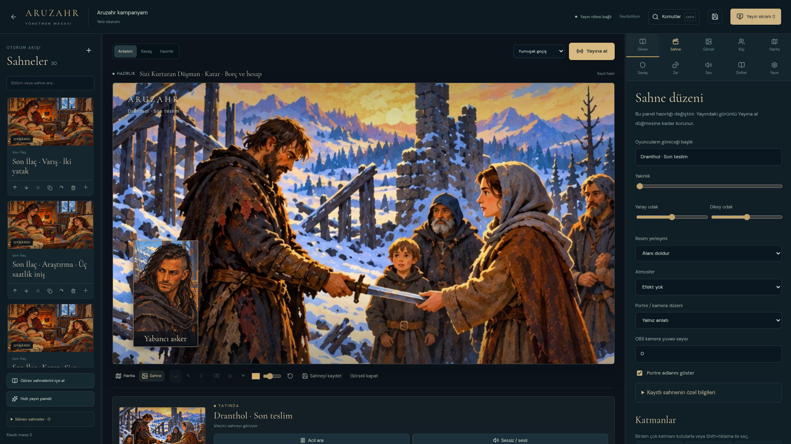
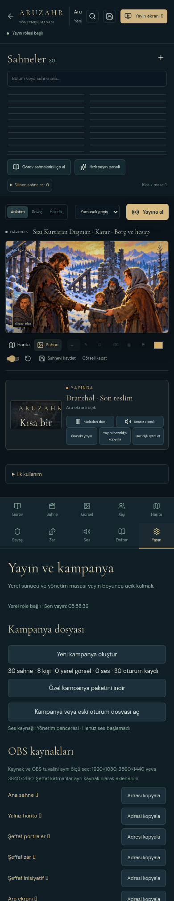

# Yayın stüdyosu — 25 Ekim 2026

Yeni masa `/#/broadcast`, temiz OBS görüntüsü `/#/broadcast/live` adresindedir. Önceki masa `/#/broadcast/classic` altında korunur. [Kullanım kılavuzu](YAYIN_STUDYOSU_KULLANIM.md) ve [tam master prompt](YAYIN_STUDYOSU_MASTER_PROMPTU.md) depodadır.

## Tamamlanan kapsam

| Alan | Kullanılabilen özellikler |
|---|---|
| Hazırlık ve canlı | Bağımsız durumlar; açık yayına alma; kesme/yumuşak geçiş/kararma; önceki yayın; hazırlığı iptal/kopyala; geri/ileri alma |
| Sahne arşivi | Kayıt, düzenleme, çoğaltma, sıra, favori, etiket, özel not, durum, çöp kutusu ve geri getirme |
| Görev yönetmeni | Sürüm 1/2 paketler; adım, okunacak söz, kontrol, görsel, karar yankısı, atlama, sıralama, düzenleme ve alternatif çıkış |
| Kişiler | Parti/NPC/düşman; gerçek ve bilinen ad; özel amaç, ses tavrı, ilişki, can ve zırh; portre/harita taşı |
| Görsel düzeni | Çoklu katman, boyut, hizalama, grup, kilit, sıra, konuşan vurgusu, OBS kamera yuvaları; büyütülen ve pikselleri gerçekten kapatılan ipuçları |
| Harita | Kalem/ok/silgi, dikkat halkası, özel/açık işaret, yol etabı, ilerleme, kamera yer imi, kalibre edilmiş mesafe, taş grubu/kilidi |
| Savaş ve zar | İnisiyatif/tur/geri alma, can/geçici can/zırh/durum/konsantrasyon; seçilebilir açık bilgi; ifadeli, avantajlı ve gizli zar; kayıt/geçmiş |
| Ses | Üç kanal, 12 özgün prosedürel ses, yerel yükleme, izin/kaynak alanı, yumuşak geçiş, tek ses kaynağı, autoplay durumu ve acil sessizlik |
| Ara ekranı | Harita döngüsü, mesaj/kampanya/oyuncu özeti, ortam, geri sayım, durdur/sürdür/uzat; süre sonunda otomatik sahne açılmaz |
| OBS | Ana sahne, harita, şeffaf portre/zar/inisiyatif ve ara çıktıları; 1080p/1440p/4K yerleşim; isteğe bağlı WebSocket 5 sahne eşleştirmesi |
| Hızlı yönetim | Üç çalışma görünümü, ayarlanabilir sütunlar, komut araması, düzenlenebilir kısayollar ve hızlı komut paneli |
| Telefon ve oylama | LAN başlatıcısı, süreli kodla eşleştirme, izinli komutlar; bağlantı tabanlı oylama/sonuç/kapatma |
| Özel kampanya | Defter, bağlı karar hatırlatmaları, ayrı DM/oyuncu özetleri; bütün yerel medya/DM ilerlemesini taşıyan dosya; önizlemeli ekleme/değiştirme |
| Toparlanma | Tek yönetici, açık devralma, eski dönem/sıra reddi, varlık tekilleştirme/bütünlük, sunucu yeniden bağlantısı, onaylı tüm verileri sıfırlama |

Mevcut lore, kanonik harita noktaları, 3D atlas ve elle boyanmış görsel koleksiyonu korunur. Bu güncellemede yeni illüstrasyon üretildiği iddia edilmez. Yeni sesler sentezlenmiş dokulardır; alan kaydı veya orkestral müzik değildir.

## Gerçek doğrulama

- Son TypeScript/Vite üretim derlemesi geçti. Önceden de bulunan büyük paket uyarısı sürer.
- Koşuların birleşiminde **87 farklı ilgili senaryonun başarılı sonucu** bulunur: 36 yeni stüdyo, 32 eski yayın, 16 atlas/wiki/pin ve üç karakter/gizlilik kontrolü. Bunlar tek 87'lik başarılı koşu gibi sunulmaz. Tam 213 senaryolu arşiv ve ağır 3D testleri bu çalışmada baştan çalıştırılmadı.
- Son üretim önizlemesinde gerçek özel paketteki **10 görev/30 sahnenin tamamı** hazırlanıp ayrı profilde yayına alındı. Bütün arka planlar, portreler ve yönetim ekranındaki canlı önizlemeler yüklendi. Özel sahne özetleri yayın iletisinde bulunmadı.
- 3840×2160 çıktılar, portre/zar/inisiyatifte alfa arka plan, ara ekranı ve 390 px yatay taşma kontrol edildi. Son üretim akışında tarayıcı hatası **0**.
- Ayrı bir yerel Vite sunucusu gerçekten kapatılıp yeniden başlatıldı. Canlı kare ve adı belirsiz varlıkları yeniden geldi; yayımlanmamış hazırlık korundu ve izleyiciye açılmadı.
- Şifreli indirmede yanlış şifre reddedildi; doğru şifreyle indirilen ZIP, özel kaynak ZIP ile bayt düzeyinde aynıydı. Parola değişmedi ve depoya yazılmadı. ZIP altı dosya içerir; eski beşli macera korunur ve güncel stüdyo kılavuzu eklenmiştir.
- `git diff --check`, başlatıcıların bash sözdizimi ve depo parola taraması temizdir.

Ara koşular ve düzeltmeler [doğrulama günlüğünde](SON_DOGRULAMA.md) açıklanır. Çalışma alanı kanıtları `/workspace/artifacts/studio/` ve ilgili `studio-*.log` dosyalarındadır. Özel DM ekran görüntüleri depoya eklenmedi; buradaki ekran görüntüsünde özel not paneli kapalıdır.

## Kullanım sınırları

Gerçek OBS masaüstü ve Windows bu Linux ortamında çalıştırılmadı. OBS WebSocket 5 kimlik doğrulaması/sahne istekleri taklit protokol sunucusuyla; yayın görüntüsü ve ses sahipliği ayrı tarayıcı profilleriyle sınandı.

Telefon aynı ağa erişim ister. Oylama için katılımcıların sunucuya ulaşabilmesi gerekir; kendiliğinden internet yayını veya Twitch sohbeti entegrasyonu yoktur. Yeni kampanya yedeği **özel ve şifresizdir**; şifreli DM teslim dosyasından farklıdır. Ağ, OBS, yedekleme ve kayıt sınırları [kılavuzda](YAYIN_STUDYOSU_KULLANIM.md) açıklanır.

